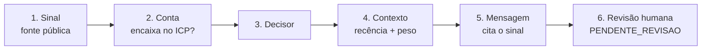

# Agente de sinais de compra para TI

Prospecção B2B **por motivo, não por lista**. O agente lê sinais coletados de fontes públicas, aplica o ICP, pontua cada conta (A/B/C) e escreve um rascunho de abordagem que **cita o sinal real**. Nenhuma mensagem é enviada sem revisão humana.

## Fluxo



## Sinais suportados

| Sinal | Peso | Exemplo |
|---|---:|---|
| `novo_executivo` | 40 | novo CIO, CTO ou CISO |
| `edital_publico` | 35 | licitação ou RFP pública de nuvem |
| `fim_contrato` | 35 | fim de contrato de data center divulgado |
| `vagas_tecnologia` | 30 | vagas de cloud, dados ou segurança |
| `expansao` | 25 | nova unidade, fusão, aquisição |
| `incidente_publico` | 20 | indisponibilidade divulgada |

A pontuação é multiplicada pela recência (até 30 dias = 100%, até 90 dias = 60%, mais antigo = 20%).
Nota **A** a partir de 30 pontos, **B** a partir de 15. Fora do ICP, sem sinal ou **sem fonte** = **C**.

## Rodar

```bash
git clone https://github.com/MoniqueSilva79/agente-sinais-de-compra.git
cd agente-sinais-de-compra
pip install -r requirements.txt
python agente.py sinais_exemplo.csv --icp icp.json --hoje 2026-11-14
```

```
[A] Alfa Seguros     PENDENTE_REVISAO  novo_executivo: novo CIO anunciado; recência: 40 pts
[A] Beta Varejo      PENDENTE_REVISAO  vagas_tecnologia: 3 vagas de engenharia de dados; recência: 30 pts
[B] Gama Logística   PENDENTE_REVISAO  edital_publico: edital público de serviços de nuvem; recência: 21 pts
[B] Delta Saúde      PENDENTE_REVISAO  expansao: a nova unidade em Campinas; recência: 15 pts
[C] Ômega Têxtil     DESCARTADA        setor fora do ICP; região fora do ICP; porte abaixo do ICP
```

A fila completa, com as mensagens, fica em `fila_de_abordagem.csv` (veja `exemplo_fila_de_abordagem.csv`).
As empresas do exemplo são **fictícias**.

Para refinar o texto com Gemini (Vertex AI):

```bash
export GOOGLE_GENAI_USE_VERTEXAI=TRUE GOOGLE_CLOUD_PROJECT=seu-projeto GOOGLE_CLOUD_LOCATION=us-central1
python agente.py sinais.csv --icp icp.json --gemini
```

O prompt proíbe inventar dados, resultados ou clientes e mantém o fato citado.

## Regras éticas e LGPD

- **Só fontes públicas e permitidas.** Este projeto não faz scraping: o CSV de entrada é montado a partir de notícias, portais de vagas, diários oficiais e páginas de licitação, respeitando os termos de cada plataforma.
- **Todo sinal precisa de fonte.** Sem link verificável, a conta vai para C.
- **Dados mínimos.** O agente trabalha com dados de empresas; contatos pessoais ficam fora do arquivo.
- **Revisão humana obrigatória.** Toda mensagem sai como `PENDENTE_REVISAO`.
- **Volume baixo, relevância alta.**

## Testes

```bash
pytest
```

## Estrutura

```
├── agente.py                       # CLI: lê CSV, pontua, gera a fila
├── pontuacao.py                    # ICP, pesos de sinal, recência e nota A/B/C
├── mensagem.py                     # rascunho por modelo + refino opcional com Gemini
├── icp.json                        # perfil de cliente ideal
├── sinais_exemplo.csv              # entrada fictícia
├── exemplo_fila_de_abordagem.csv   # saída de exemplo
└── test_agente.py
```

---
Autora: **Monique Silva** · Pré-vendas Cloud & IA · 7x certificada Google Cloud
